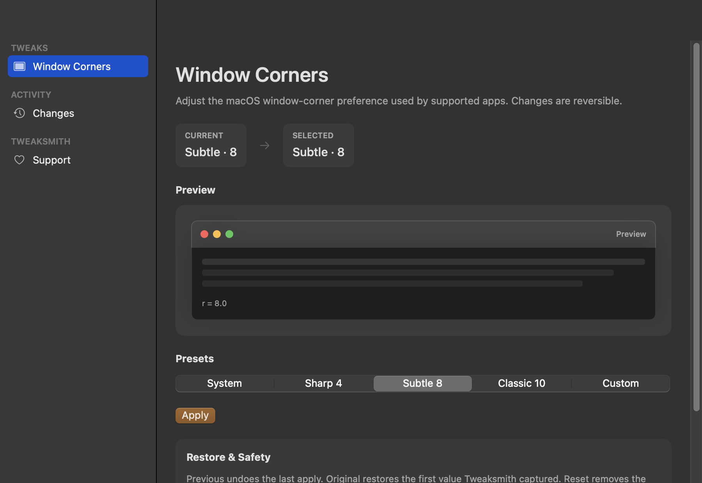
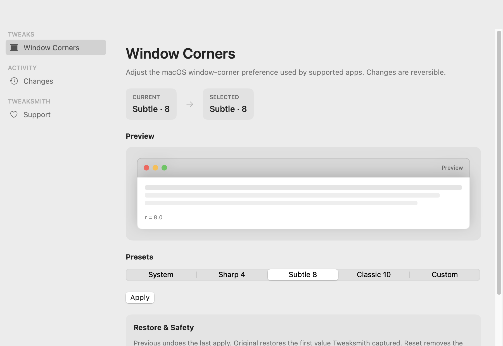
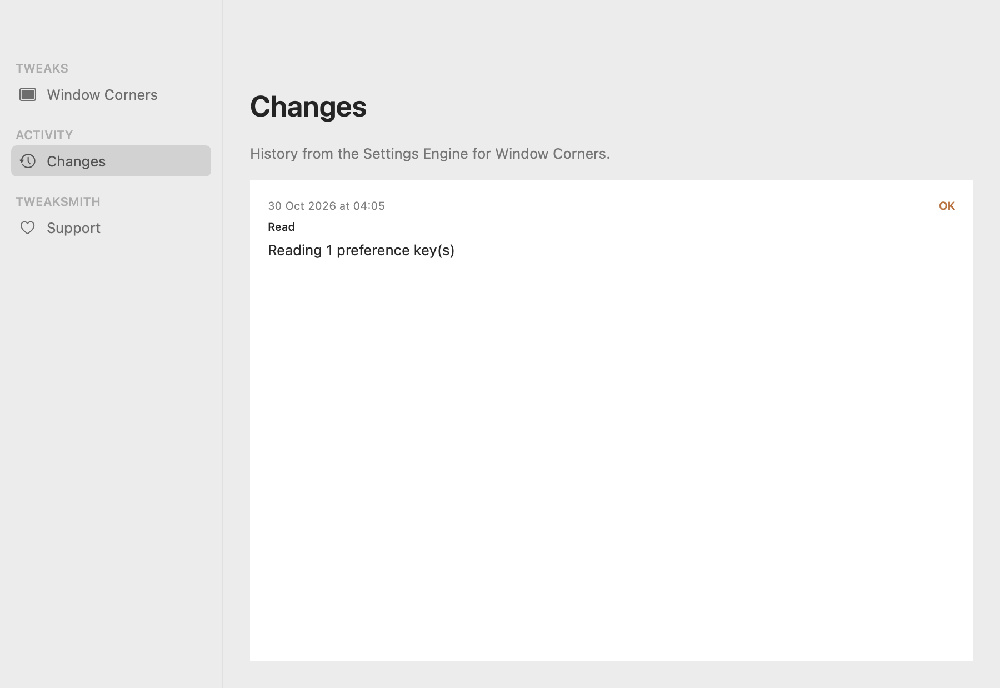

# Tweaksmith

**Make your Mac yours.**

Free, open-source native macOS utility — modular, reversible, and private.

**An Open Source Group project.**

**Maintained by Kamyab Infotech.**







---

## Principles

- **Free & OSS (MIT)** — no locked features, no accounts, no ads, no telemetry
- **Native** — Apple Silicon first; macOS **Tahoe 26+**
- **Reversible** — Settings Engine backup, history, and restore
- **Safe** — no SIP disable, no Gatekeeper disable, no kernel extensions
- **Voluntary support** — pay-what-it’s-worth never unlocks features

Read the full contract: [`docs/PRODUCT_PRINCIPLES.md`](docs/PRODUCT_PRINCIPLES.md).

---

## Status

**Developer Preview 2 · Unsigned · For technical users.** Settings Engine + Window Corners + Changes + Support. Published as a GitHub **pre-release** — **not** Developer ID signed or notarized; **not** Stable. Stable Gatekeeper v0.1 remains **BLOCKED** until Developer ID + notarization. See [`docs/RELEASE_GATE_VERDICT.md`](docs/RELEASE_GATE_VERDICT.md).

Download (Developer Preview 2): [GitHub Pre-release `v0.1.0-dev.2`](https://github.com/OpenSourceGroup/tweaksmith/releases/tag/v0.1.0-dev.2)

macOS may require **System Settings → Privacy & Security → Open Anyway**. Do not disable Gatekeeper or SIP.

---

## Support (voluntary)

Tweaksmith is free open-source software. **Payment never unlocks features.**

- Pay what it’s worth on the production support page: [kamyab.co.in/tweaksmith/support](https://kamyab.co.in/tweaksmith/support)
- Suggested amounts: ₹199 / ₹499 (Recommended) / ₹999 / Custom
- Checkout runs in the browser only (Razorpay). The Mac app never handles card data.

---

## Quick links

| Doc | Purpose |
|-----|---------|
| [Architecture](docs/ARCHITECTURE.md) | App structure & Settings Engine |
| [Compatibility](docs/COMPATIBILITY.md) | OS support & Window Corners notes |
| [Development](docs/DEVELOPMENT.md) | Engine rules, tests, local commands |
| [Roadmap](docs/ROADMAP.md) | Now / Next / Later |
| [Contributing](CONTRIBUTING.md) | PR flow & tests |
| [Security](SECURITY.md) | Vulnerability reporting |
| [Governance](GOVERNANCE.md) | Project, maintainer, releases |
| [Release process](docs/RELEASE_PROCESS.md) | RC → gate → production |

---

## Development

```bash
./scripts/bootstrap-check.sh
./scripts/run-smoke.sh
./scripts/release-gate.sh   # human checklist — see docs/RELEASE_GATE.md
./scripts/package-release.sh 0.1.0-dev.2   # SwiftPM .app zip + SHA-256 under dist/
```

```bash
swift test   # needs Xcode/XCTest; CLT hosts use run-smoke.sh
# tests must use isolated preference domains — never mutate global runner prefs
```

---

## License

Code: [MIT](LICENSE). Copyright in that file stays **Kamyab Infotech Private Limited** until a legal owner decides otherwise. This README does not transfer copyright to Open Source Group.

---

## Contact

- Open Source Group: [osg.co.in](https://osg.co.in)
- GitHub: [OpenSourceGroup/tweaksmith](https://github.com/OpenSourceGroup/tweaksmith)
- Product: [kamyab.co.in/tweaksmith](https://kamyab.co.in/tweaksmith)
- Maintainer: [Kamyab Infotech](https://kamyab.co.in) (never kamyab.in)
- Security: security@kamyab.co.in — see [SECURITY.md](SECURITY.md)
